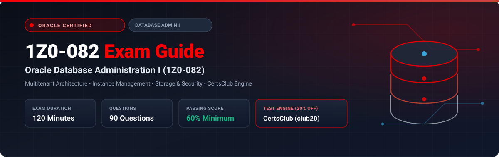

<p align="center">
  
</p>

# Oracle Database Administration I (1Z0-082) Exam Study Guide & Practice Test Resource Portal

[-f80000?style=for-the-badge&logo=oracle&logoColor=white)](https://education.oracle.com/)
[](https://education.oracle.com/)
[](https://education.oracle.com/)
[](https://education.oracle.com/)
[](https://education.oracle.com/)
[-28a745?style=for-the-badge&logo=shield)](https://www.certsclub.com/oracle/)

---

## 1. Exam Overview & Candidate Profile

The **Oracle Database Administration I (1Z0-082)** exam represents the essential core test for any modern Oracle Database Administrator. It validates foundational competence across both SQL data manipulation and core database administration topics on Oracle Database 19c. Candidates are tested on their ability to configure multitenant Container Databases (CDBs) and Pluggable Databases (PDBs), administer instance memory and background processes, manage tablespaces and datafiles, configure Oracle Net Services, and enforce user access security.

Passing the 1Z0-082 exam serves as the required prerequisite milestone toward achieving the prestigious **Oracle Database Administration Certified Professional (OCP DBA)** credential.

### Target Candidate Profile & Career Roles
* **Junior to Mid-Level Oracle Database Administrators (DBAs)**
* **Database Support Specialists & System Engineers**
* **Technical Application Administrators Managing Oracle Backends**
* **Prerequisites:** Familiarity with basic SQL queries, command-line Linux navigation, and general relational database concepts.

---

## 2. Key Exam Specifications

| Parameter | Official Specification |
| :--- | :--- |
| **Exam Code** | 1Z0-082 |
| **Exam Title** | Oracle Database Administration I |
| **Credential Track** | Step 1 towards Oracle Database Administration Certified Professional |
| **Duration** | 120 Minutes |
| **Number of Questions** | 90 Questions |
| **Passing Score** | 60% |
| **Question Format** | Multiple Choice (Single and Multiple Select) |
| **Delivery Vendor** | Pearson VUE / Oracle University Online Remote Proctoring |
| **Recommended Practice Test Engine** | **[1Z0-082 Practice Test - CertsClub](https://www.certsclub.com/oracle/)** (Coupon: `club20` for 20% off) |

---

## 3. Official Blueprint & Exam Domain Breakdown

| Domain Code | Domain Title | Weighting | Key Competencies Covered |
| :--- | :--- | :---: | :--- |
| **1.0** | **Oracle Database Architecture & Multitenant Foundations** | **22%** | CDB and PDB architecture, Root (CDB$ROOT), Seed (PDB$SEED), System and User PDBs; Instance memory architecture (SGA: Buffer Cache, Shared Pool, Redo Log Buffer; PGA); Mandatory background processes (DBWn, LGWR, CKPT, SMON, PMON). |
| **2.0** | **Managing Database Instances & Networking** | **18%** | Initialization parameter files (PFILE vs SPFILE); Instance state transitions (`SHUTDOWN` -> `NOMOUNT` -> `MOUNT` -> `OPEN`); Configuring Oracle Net Listener (`listener.ora`), local naming resolution (`tnsnames.ora`), and communication parameters (`sqlnet.ora`). |
| **3.0** | **Managing Storage Structures & Space** | **20%** | Creating and managing Permanent, Temporary, and Undo tablespaces; Bigfile vs Smallfile tablespaces; Oracle Managed Files (OMF); Tablespace compression and offline/online status; Monitoring datafile growth and space reclamation. |
| **4.0** | **Database Security, User Administration & Privileges** | **18%** | Creating common and local database users in multitenant environments; Managing System Privileges, Object Privileges, and Roles; Configuring user profiles for password expiration, lockouts, and resource limits. |
| **5.0** | **Basic Backup, Recovery & Maintenance** | **22%** | Configuring `ARCHIVELOG` mode and Fast Recovery Area (FRA); Basic RMAN architecture and connection commands; Performing whole database backups; Data Pump export (`expdp`) and import (`impdp`) fundamentals. |

---

## 4. Deep Dive into Complex Exam Topics

### 4.1 Common vs Local Users in Multitenant Architecture
* **Common Users:** Exist in `CDB$ROOT` and can access all open PDBs where permissions are granted. Must begin with the prefix `c##` or `C##` (unless `_oracle_script=true` is set).
  ```sql
  -- Connected to CDB$ROOT:
  CREATE USER c##sec_admin IDENTIFIED BY password CONTAINER=ALL;
  ```
* **Local Users:** Exist only in a specific PDB and have no privileges outside that single PDB container. Cannot start with `c##`.
  ```sql
  -- Connected to PDB1:
  CREATE USER app_user IDENTIFIED BY password CONTAINER=CURRENT;
  ```

### 4.2 Instance Startup Phases and File Requirements
* **`STARTUP NOMOUNT`:** Reads the `PFILE`/`SPFILE`, allocates the System Global Area (SGA), and starts background processes. Does **not** open or verify control files.
* **`STARTUP MOUNT`:** Opens and reads the control file(s) specified in the parameter file. Verifies the existence and headers of control files, but does **not** open datafiles or redo log files.
* **`STARTUP OPEN`:** Opens all online datafiles and online redo logs. Performs instance recovery via SMON if the prior shutdown was abortive or unclean.

---

## 5. Scenario-Based Demo Questions & Technical Explanations

### Question 1: Tablespace Space Management & Datafile Resizing
**Scenario:** A DBA notices that the `APP_DATA` tablespace has exhausted its allocated space, causing insert errors in user sessions. The tablespace currently contains one datafile located at `/u01/app/oracle/oradata/proddb/app_data01.dbf` sized at 10GB. The filesystem has 100GB of available free storage.

Which two independent commands can the DBA execute to successfully resolve the out-of-space condition immediately? (Choose two)

A)
```sql
ALTER DATABASE DATAFILE '/u01/app/oracle/oradata/proddb/app_data01.dbf' RESIZE 25G;
```

B)
```sql
ALTER TABLESPACE app_data ADD DATAFILE '/u01/app/oracle/oradata/proddb/app_data02.dbf' SIZE 15G AUTOEXTEND ON NEXT 1G MAXSIZE 50G;
```

C)
```sql
ALTER TABLESPACE app_data SHRINK SPACE CASCADE;
```

D)
```sql
ALTER DATABASE MOVE DATAFILE '/u01/app/oracle/oradata/proddb/app_data01.dbf' TO '/u02/app_data01.dbf';
```

**Correct Answer:** **A and B**

**Detailed Explanation:**
* Option **A** directly resizes the existing datafile from 10G to 25G using `ALTER DATABASE DATAFILE ... RESIZE`, instantly providing 15GB of additional usable storage.
* Option **B** adds a second datafile to the tablespace with autoextend enabled (`ALTER TABLESPACE ... ADD DATAFILE ... AUTOEXTEND ON`), resolving the space bottleneck.
* Option **C** (`SHRINK SPACE`) reclaims unused fragmented space from tables/indexes, but if space is genuinely exhausted by valid data, it will not provide the required capacity.
* Option **D** relocates the datafile to another mount point without increasing tablespace storage capacity.

---

## 6. Recommended Preparation Strategy & Practice Testing Engine

To ensure a first-time pass on 1Z0-082:

1. **Practice Multitenant Administration Hands-On:** Install Oracle Database 19c on Linux and configure CDBs, PDBs, plug/unplug operations, and user profiles.
2. **Master Oracle Net Services Configuration:** Practice configuring listener ports, service registrations, and troubleshooting connection failures using `lsnrctl status` and `tnsping`.
3. **Practice Full-Length Simulated Exams:** Use **[CertsClub Oracle 1Z0-082 Practice Tests](https://www.certsclub.com/oracle/)**.
   * Comprehensive coverage of multitenant questions, RMAN fundamentals, and SQL tasks.
   * Timed simulation mode replicates Pearson VUE testing constraints.
   * Use coupon code **`club20`** at checkout on [CertsClub](https://www.certsclub.com/oracle/) for 20% off.

---

## 7. Official Documentation & References

* [Oracle Database Administrator's Guide 19c](https://docs.oracle.com/en/database/oracle/oracle-database/19/admin/)
* [Oracle University 1Z0-082 Certification Track](https://education.oracle.com/)
* [CertsClub 1Z0-082 Practice Engine](https://www.certsclub.com/oracle/)

---

## 8. SEO & Discovery Keywords
```
1z0-082, 1z0-082 dumps, 1z0-082 exam questions, oracle database administration I exam,
oracle dba associate 1z0-082, 1z0-082 practice test, certsclub 1z0-082, multitenant cdb pdb,
spfile startup mount, oracle tablespace datafile autoextend
```
